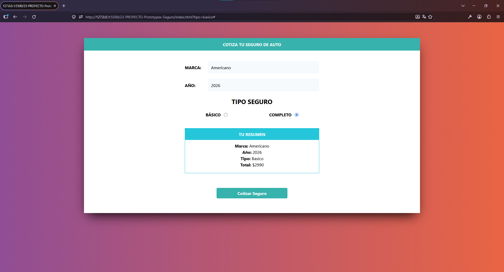

# Cotizador de Seguro de Auto con JavaScript

Aplicación web que calcula una cotización estimada de seguro de auto a partir de tres opciones: procedencia de la marca, año del vehículo y tipo de cobertura. El proyecto practica el uso de funciones constructoras y `prototype` en JavaScript.

Fue desarrollado como ejercicio del curso **JavaScript Moderno: Guía Definitiva Construye +10 Proyectos**.

## Demo

[Ver el proyecto en GitHub Pages](https://cristhianychr.github.io/cotizador-prototypes-js/)

## Vista previa



## Funcionalidades

- Selección de la procedencia de la marca: americano, asiático o europeo.
- Selección del año del vehículo entre el año actual y los 20 años anteriores.
- Elección entre cobertura básica y completa.
- Validación para exigir que se seleccione una marca.
- Cálculo de una cotización estimada según la marca, la antigüedad y el tipo de cobertura.
- Mensajes temporales para indicar errores o que se está realizando la cotización.
- Indicador de carga durante la simulación.
- Presentación de un resumen con la marca, el año, la cobertura y el importe calculado.

## Tecnologías utilizadas

- **HTML5** para la estructura del formulario.
- **Tailwind CSS** para el diseño y los estilos de la interfaz.
- **CSS personalizado** en `css/custom.css` para los estilos específicos y el indicador de carga.
- **JavaScript** para la lógica de cotización, validaciones y actualización de la interfaz.
- **Git y GitHub Pages** para el control de versiones y la publicación.

## Conceptos de JavaScript practicados

- Funciones constructoras (`Seguro` y `UI`).
- Creación de métodos mediante `Seguro.prototype` y `UI.prototype`.
- Instanciación de objetos con `new`.
- Propiedades y métodos de objetos.
- Manejo de eventos con `addEventListener`.
- Prevención del envío tradicional del formulario con `preventDefault()`.
- Selección y manipulación de elementos del DOM.
- Generación dinámica de opciones con `createElement()` y `appendChild()`.
- Lectura de valores de controles `select` y `input`.
- Condicionales y `switch`.
- Cálculos aritméticos a partir de las opciones seleccionadas.
- Desestructuración de objetos.
- Inserción y eliminación de elementos HTML.
- Temporizadores con `setTimeout`.

## ¿Cómo se calcula la cotización?

El código define una tarifa base de **$2,000** y aplica estos factores según la procedencia seleccionada:

| Procedencia | Factor aplicado |
|---|---:|
| Americana | 1.15 |
| Asiática | 1.05 |
| Europea | 1.35 |

Después, reduce el importe en un 3 % por cada año de antigüedad del vehículo y aplica un factor adicional asociado al tipo de cobertura.

**Importante:** se trata de una fórmula educativa de ejemplo, no de una cotización comercial ni de una tarifa real de seguros.

## Estructura del proyecto

```text
cotizador-prototypes-js/
├── css/
│   ├── custom.css
│   └── tailwind.css
├── img/
│   └── preview.png
├── js/
│   └── app.js
├── index.html
├── .gitignore
└── README.md
```

## Ejecutar localmente

No es necesario instalar dependencias para ejecutar la versión incluida en el repositorio.

1. Clona el repositorio:

   ```bash
   git clone https://github.com/cristhianychr/cotizador-prototypes-js.git
   ```

2. Accede a la carpeta:

   ```bash
   cd cotizador-prototypes-js
   ```

3. Abre `index.html` en tu navegador. También puedes abrir la carpeta con Visual Studio Code y utilizar una extensión como Live Server.

## Limitaciones conocidas

- La cotización es una simulación local: no consulta aseguradoras, servicios externos ni bases de datos.
- En la implementación actual, la condición que evalúa el tipo de cobertura asigna `basico` en vez de compararlo. Por eso, el cálculo utiliza siempre el factor de cobertura básica, incluso si se selecciona **Completo**. Para que ambas opciones calculen importes distintos, debe corregirse la condición en `js/app.js` antes de presentar el proyecto como completamente funcional.

## Curso

Proyecto realizado como parte del curso **JavaScript Moderno: Guía Definitiva Construye +10 Proyectos**, con fines de aprendizaje y práctica de JavaScript.

## Autor

**Cristhian Chanamé**  
Estudiante de Ingeniería de Software.